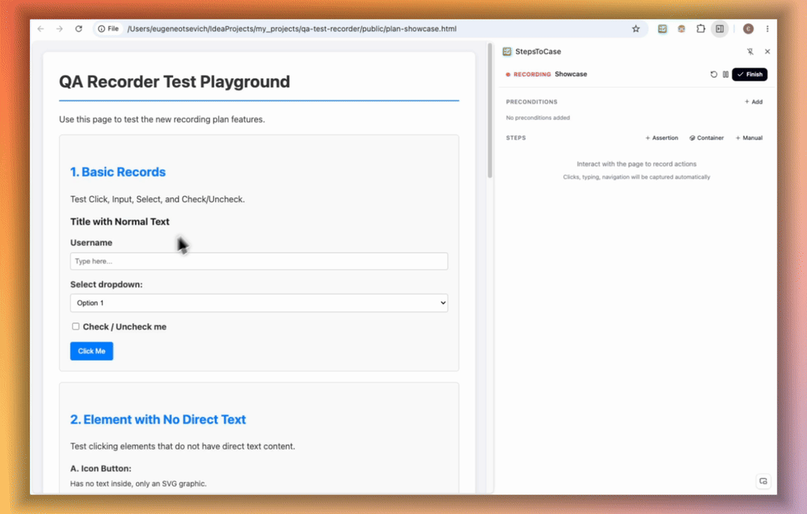

# StepsToCase

**Record a manual test once. Get a readable test case and the data to generate automated tests.**

StepsToCase is a Chrome extension for QA engineers. You walk through a test in the browser as usual; the extension records every step with the exact element details, and exports a clean test case plus a JSON file that an AI coding agent can turn into Playwright, Cypress or Selenium tests, without guessing selectors.

<p>
  <a href="https://eotsevych.github.io/steps-to-case/"><strong>📖 Documentation & video guide</strong></a>
  &nbsp;·&nbsp;
  <a href="https://chromewebstore.google.com/detail/stepstocase/eekhjmlfbikagoennaldhdbliogklfec"><strong>🧩 Install from the Chrome Web Store</strong></a>
  &nbsp;·&nbsp;
  <a href="https://eotsevych.github.io/steps-to-case/privacy">🔒 Privacy policy</a>
</p>



## Why

- **Manual test cases get vague.** Steps written in a hurry are hard to follow a month later. A recording is exact: every click, value and page.
- **The first manual run is wasted for automation.** StepsToCase collects the automation data while you test, so the same run feeds both the test case and the automated test.
- **AI guesses locators.** Give an AI a five-line prompt and it invents selectors. Give it the recorded JSON and it works from real element attributes, containers and page structure.

## How it works

1. **Record.** Open the side panel, name the test and click **Start Recording**. Clicks, typing, selects, checkboxes and key presses become steps. Steps are grouped by page automatically.
2. **Add context.** Add assertions, manual steps and preconditions. Pick a **container** (a table row, card or dialog) when the same button appears many times on the page.
3. **Organize.** Rename, reorder or delete steps, and merge several clicks into one business step.
4. **Export.** Get an AI prompt, a ready-made readable test case, and a JSON file with every page, step, element and container.
5. **Generate tests.** Hand the JSON to your AI coding agent with your framework's rules, then let it run and fix the test until it passes.

Each step is covered in detail, with short videos, in the **[documentation](https://eotsevych.github.io/steps-to-case/)**.

## Generate tests in your own framework

[`skills/stepstocase-setup`](skills/stepstocase-setup) is an agent skill that builds a test generator for your project. It works in Claude Code, Cursor, GitHub Copilot, Codex, Gemini CLI and any other agent that supports [Agent Skills](https://agentskills.io). It scans your test framework (Playwright, Cypress, Selenium, WebdriverIO, Selenide, BDD; any language), asks only the questions the scan cannot answer, and writes a `stepstocase-generate-test` skill that follows your conventions. It installs that skill for every agent your team uses, then tests it on one of your recordings.

Install it in your test repo. The installer asks which agents to install for:

```bash
npx skills add eotsevych/steps-to-case --skill stepstocase-setup
```

Then ask your agent: "use stepstocase-setup with path/to/recording.json" (in Claude Code: `/stepstocase-setup path/to/recording.json`).

## Features

- Records click, double click, fill, press, select, check and uncheck
- Follows the flow across pages, popups, new tabs and iframes
- Assertions: text equals / contains, visible, hidden, enabled, disabled, checked, unchecked
- Containers to make repeated elements unique
- Scored CSS selectors with configurable attribute priority (`data-testid`, `id`, `data-*`, …)
- Page and component tags for Page Object Model code generation
- Single Page mode for building one page object
- Records the API calls each step triggers, so generated tests can wait on them
- Password values are masked
- Everything stays in your browser (`chrome.storage.local`). Nothing is sent to any server.

## Build from source

```bash
npm ci
npm run build        # production build into dist/
npm run dev          # watch mode
npm run typecheck    # tsc --noEmit
npm test             # unit tests (vitest)
```

Load it in Chrome: open `chrome://extensions`, turn on **Developer mode**, click **Load unpacked**, and select `dist/`.

## How the code is organized

Three entry points, built by Vite:

1. **Service worker** (`src/background/service-worker.ts`): holds the recording state and handles all messages from the panel and content scripts. Groups recorded actions into pages by URL.
2. **Content script** (`src/content/content-script.ts`): attaches DOM listeners while recording, collects element info, page context and selectors for each action, and tracks the network requests each action triggers. Also runs the element and container picker.
3. **Side panel** (`sidepanel.html` + `src/panel/`): the React UI. Phases: start screen → recording → review → export.

Key modules:

- `src/injected/selectorGenerator.ts`: generates and scores CSS selector candidates (lower score is better).
- `src/injected/metadataCollector.ts`: element info (tag, text, accessible name, label, attributes) and page context.
- `src/lib/exporter.ts`: builds the export JSON and the readable test case.
- `src/types/index.ts`: shared types and message definitions; the source of truth for the data model.

```
Content script ──ACTION_CAPTURED──► Service worker ──STATE_UPDATED──► Side panel
               ◄──START / STOP────                 ◄──panel commands──
```

`@/*` maps to `src/*` (in `tsconfig.json` and `vite.config.ts`). The documentation site lives in `docs/` and is published with GitHub Pages.

## Changelog

See [CHANGELOG.md](CHANGELOG.md) (English and Ukrainian).

## License

[GNU AGPL-3.0](LICENSE). You may use, change and share this code, but any version you distribute or run as a service must also be released under the AGPL with its source code.
